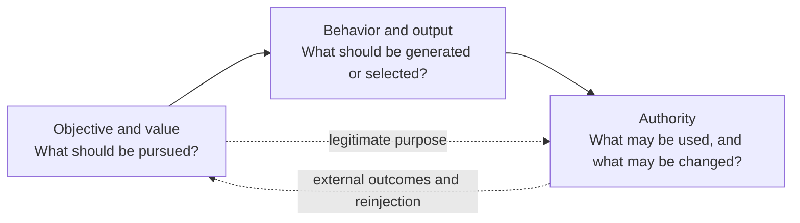
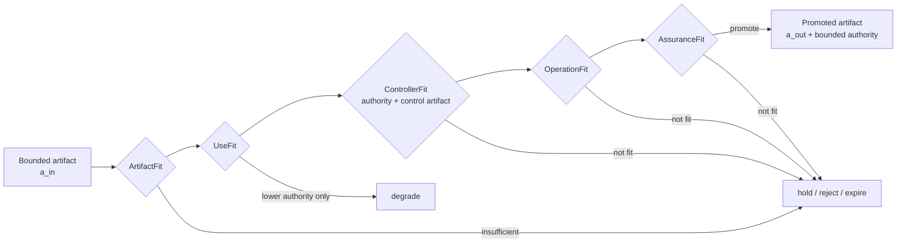
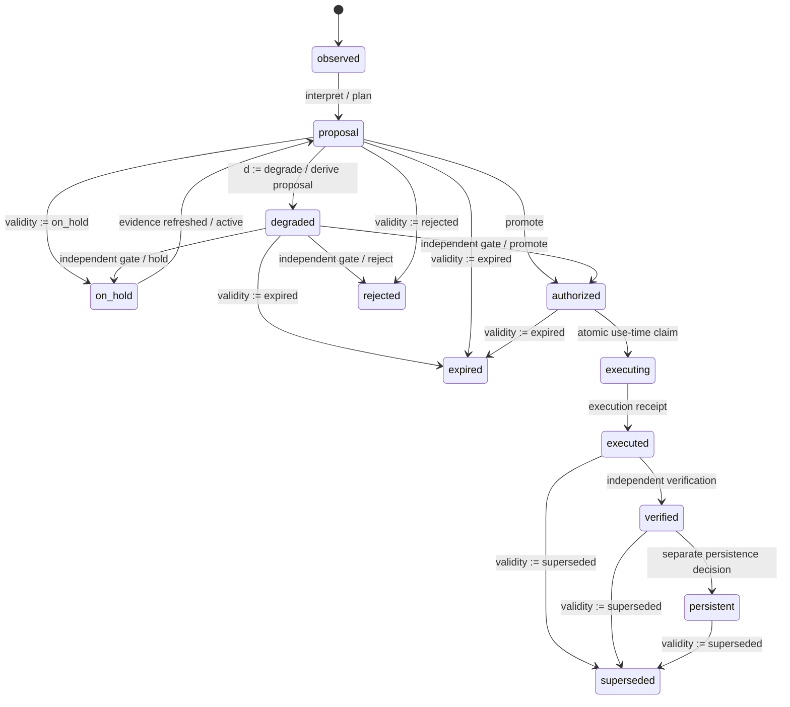
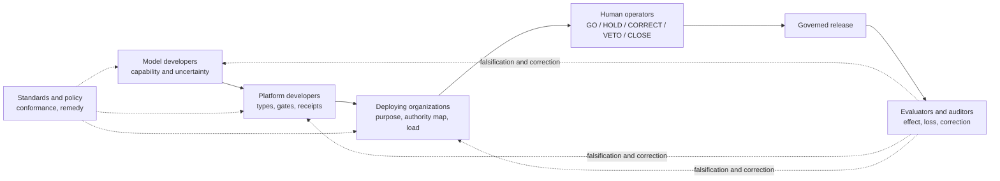

# Boundary-Preserving Alignment

## From Bounded Artifacts to Bounded Authority: Implementing Safety in Long-Horizon Human-AI Systems Through the Governance of Authority Promotion

**Kentaro Sato**  
Independent Researcher  
[info@metaclan.jp](mailto:info@metaclan.jp)

**English Revised Edition v1.1 / 2026-11-05**  
**Article type:** Position paper on AI safety and alignment

---

## Reader's Note

This paper does not replace existing AI-safety research on model objectives, value learning, robustness, interpretability, adversarial evaluation, or capability evaluation. Nor does it claim that any particular implementation, audit ledger, human-in-the-loop arrangement, or final human approval guarantees safety by itself.

It proposes a distinct but complementary design layer: governance of the conditions under which AI-generated summaries, evaluations, hypotheses, candidate intentions, plans, tool calls, execution results, and memories may be promoted to particular uses with particular degrees of authority. Section 1.2 provides the canonical definition of the terminology used in this paper.

The central position is simple:

> Exploration may be broad. Authority must be narrow, use-specific, time-bounded, and revalidatable.

---

## Abstract

AI alignment is often framed as the problem of bringing a model's objectives, outputs, preferences, or behavior into accord with human values and intentions. In long-horizon human-AI systems that maintain memory, connect multiple models and tools, and modify external state, however, a major accident pathway arises when a locally valid output is promoted into display, execution, persistence, publication, or reinjection after losing the provenance, scope, time, uncertainty, representational conditions, or authority that justified it. The human supervising that promotion is also not an ideal adjudicator with unlimited attention, memory, time, or independence.

This paper connects two design perspectives, the **safe promotion of bounded artifacts** and the **finite-bandwidth human operator**, and expands the implementation unit of AI safety from the model alone to the sociotechnical system that generates, inspects, promotes, executes, verifies, and returns artifacts to memory. Each artifact retains not only content but also provenance, scope, time, generation or measurement conditions, missingness and uncertainty, permitted uses, and authority state. Capability is separated from authority. Authority is not granted wholesale to a system or session, but assigned to an atomic target use as a one-shot, expiring, and revocable authorization. Between approval and execution, state, evidence, budget, permission, and stop conditions are revalidated at use time.

The paper assumes that corrigibility, AI control, action alignment, least privilege, attribute-based access control, zero trust, and runtime governance already address authority, stopping, and external enforcement. Its novelty claim is not authority control itself. Rather, it treats epistemic artifacts, external execution, independent verification, memory, publication, and reinjection within a single promotion graph, and joins false promotion, false suppression, and finite-bandwidth human control in one audit vocabulary.

The paper advances five principal recommendations. First, evaluate AI safety as a property of systems rather than models alone. Second, institutionally separate capability evaluation from the granting of authority. Third, treat human-in-the-loop not as the presence of a human but as a conformance state satisfying referential clarity, local sufficiency, intent ownership, evidence calibration, legitimate authority, decision capacity, temporal freshness, and downstream understanding. Fourth, measure not only false promotion but also false suppression of legitimate candidates, pre-observation loss, and missing audit paths. Fifth, make the responsibilities of model developers, agent-platform developers, deploying organizations, evaluators, and standards and policy bodies explicit at each authority-promotion boundary.

Boundary-preserving alignment does not assume a perfectly benevolent model. It begins from the premise that models, evaluators, humans, and organizations can all fail, and requires a structure in which an error is not immediately promoted into an irreversible outcome. It is not a solution to the alignment problem. It is an implementable governance layer for preventing unresolved alignment problems from being coupled directly to unbounded authority.

**Keywords:** AI safety, AI alignment, agentic systems, bounded artifacts, bounded authority, human oversight, authority promotion, least privilege, provenance, finite-bandwidth operator, auditability, recoverability

---

# 1. Introduction

## 1.1 From What Was Generated to What It Was Treated As

The safety of an AI system is not determined solely by the truth, harmfulness, refusal performance, or adversarial robustness of its outputs. Real systems place routers, retrieval components, summarizers, evaluators, fallbacks, long-term memory, tools, schedulers, access control, audits, and human judgment before and after the model. A single sentence generated by a model may serve as a response candidate, a summary of a user's speech, a future retrieval index, a continuing goal, an argument to an external tool, evidence of execution success, or a premise for the next session. This motivates a systems view of safety: Leveson locates safety in the control structure, not just in component reliability [3]; Raji and colleagues trace accountability through an end-to-end internal audit [10].

The key point is that even an identical string requires different evidence and authority when its use changes.

- Being useful as a summary does not mean that it may be quoted as the user's own statement.
- Being able to generate a plan does not mean that the model may execute it.
- A successful tool call does not mean that the intended objective was achieved.
- Achieving the objective does not mean that the experience may be fixed in long-term memory or future policy.
- A human's prior approval does not mean that the approval remains valid after the state changes.

The unit of failure is therefore not merely an incorrect output. More generally, it is **the promotion of an artifact that is valid only under bounded conditions into a stronger epistemic or operational status after those conditions have been lost**.

## 1.2 Position of This Paper

This paper argues that, in addition to a model's internal state, the **boundaries of authority promotion** should be treated as a central design object in AI safety.

> We must design not only what an AI thinks, but what the AI generates, under whose authority, for which use, at what time, and with what degree of irreversibility may be promoted into the world.

**Definition 1 (Boundary-Preserving Alignment).**  
Boundary-Preserving Alignment is a **system-design principle that, whenever an artifact moves into display, execution, persistence, publication, or reinjection, revalidates its provenance, scope, time, generation conditions, uncertainty, permitted uses, and authority state; prevents unjustified increases in authority; and simultaneously keeps the suppression, missingness, and pre-observation loss of legitimate candidates measurable**.

Here, *preservation* does not mean retaining raw data forever. It means **maintaining the distinctions needed for justification, in a verifiable form, for only as long as the target use requires them**. Depending on the case, a content reference, digest, version, reason code, use envelope, and deletion record may be sufficient. The framework therefore does not require indefinite logging that would conflict with privacy, erasure obligations, or data minimization.

In the paper's guiding phrase, **exploration** means candidate generation, hypothesis formation, simulation, sandboxed verification, and reads within a preauthorized scope that have no irreversible external side effects. When external search, network communication, tool calls, or interruption of the user consume money, disclose information, consume attention, or alter external state, they are not "internal exploration" but promotion events on the corresponding authority plane. "Exploration may be broad" does not mean that the space of unauthorized actions may be broad.

## 1.3 What This Paper Adds

This paper adds at least three auxiliary distinctions to existing AI-alignment research.

First, it distinguishes **behavioral alignment** from **authority alignment**. Even if a model generates desirable answers with high probability, the system is not safe if its outputs are automatically promoted into inappropriate uses. Conversely, even when model behavior is not fully predictable, accident probability and scope of impact can be reduced if authority to cause external effects is narrow, staged, and recoverable, or if any irreversible portion is explicitly bounded.

Second, it treats human-in-the-loop not as a binary component but as a conditional conformance state. The presence of a human on a screen, a click on an approval button, or the assignment of legal responsibility is not equivalent to meaningful control [1,2,4,6].

Third, it expands the unit of alignment evaluation from model responses to **promotion events** from generation through persistence. Safety must be evaluated with denominators that include not only outputs that passed, but also held, rejected, expired, and degraded artifacts, candidates that disappeared before observation, and events lost from the audit ledger.

## 1.4 What This Paper Does Not Claim

This paper does not claim that boundary design alone can solve deception, power seeking, goal misgeneralization, jailbreaks, supply-chain compromise, insider threats, or organizational misconduct. Research on the alignment of model behavior and objectives remains independently necessary [8,9]. Nor does it claim that a human should individually approve every high-impact act. Repetitive, reversible, low-risk operations can be automated within explicit budgets, authorities, and stop conditions.

The claim is narrower: **unresolved model-alignment problems must not be connected directly to unbounded social or operational authority**.

## 1.5 Target Systems, Intended Readers, and Objective

The primary target is an **agentic system** in which an LLM or another generative model is connected to at least one external API, file system, code-execution environment, notification channel, long-term memory, or publication path, and can cause state changes across multiple processing stages or sessions. Some principles also apply to one-shot static question answering, but the central problem appears in long-running environments where artifacts are reused by downstream processes.

The intended readers are developers of agent platforms and AI products, AI-safety and AI-governance researchers, organizational risk and audit personnel, standards bodies, and technical staff at regulatory authorities. The objective is not to provide a proof of safety, but to present (1) a common audit vocabulary, (2) implementable design principles, (3) falsifiable evaluation hypotheses, and (4) minimum evidence of implementation for each stakeholder, thereby establishing a starting point for comparative experiments and standardization.

Chapter 2 clarifies the boundary between this contribution and related work. Chapters 3 onward present the paper's formalization, design propositions, implementation structure, and evaluation hypotheses.

---

# 2. Relation to Prior Work and the Boundary of Novelty

This chapter is not an exhaustive systematic review. It uses primary sources that directly overlap with the paper's claims in order to delimit novelty. The importance of authority control, runtime control, corrigibility, least privilege, and auditability is not claimed here as a new discovery.

## 2.1 Corrigibility, Interruptibility, and AI Control

Research on corrigibility studies motivational structures under which an agent does not resist external correction, shutdown, or modification of its objective [12]. Safe interruptibility formalizes conditions under which a learning agent does not learn to avoid or induce interruption [13], while shutdown instructability connects compliance with human shutdown instructions to human autonomy and non-interference [14]. AI control evaluates protocols that use trusted models and limited human labor to prevent harm even when a powerful model intentionally attempts to violate safety procedures [15]. Recent work on effective controllability similarly treats stopping, overriding, redirection, and constraint as first-class runtime-control objectives [18].

Bostrom distinguishes changing an agent's motivations from limiting what it can do; confinement is one example of the latter [22]. Boundary-preserving alignment partially overlaps with this tradition, but its principal object is dynamic delegation: granting or denying authority per artifact, use, and time while retaining the same underlying capability, rather than enclosing the entire system within one undifferentiated box.

Boundary-preserving alignment does not prove that a model welcomes correction, nor does it directly estimate the safety margin of a control protocol against intentional subversion. It targets **the unjustified promotion of an artifact's epistemic status or operational authority**, which can occur even when the model is not adversarial. It also places multiple boundaries, from display and attribution through execution, verification, persistence, publication, and reinjection, and the finite-bandwidth human who adjudicates them, within the same audit unit rather than considering only a stop signal.

## 2.2 Action Alignment, Irreversibility Control, and Runtime Governance

Action alignment frames agent harm not primarily in terms of output content but in terms of the relationship between the authority exercised by an action and the authority granted by the user, and argues that least privilege should be enforced outside the model at the action boundary [20]. This strongly overlaps with the position here that capability does not imply authority. Frameworks for controlling irreversibility address the danger of concentrating authority over irreversible decisions, mobilization of physical resources, and self-expansion in a single high-efficiency node [19]. AgentBound composes delegation, owner-signed policies, and site contracts to produce pre-execution judgments and cryptographically verifiable governance receipts [21].

This paper therefore does not claim priority for the proposition that action authority should be constrained outside the model. Its distinctive focus is to (1) treat summaries, evaluations, and intention formation before the action boundary, and verification, memory, and publication after it, within one promotion graph; (2) separate destination from atomic target use; (3) measure false promotion and false suppression as two sides of the same boundary; and (4) incorporate human approval as a finite-bandwidth control artifact in that same graph.

References [18]--[21] are closely adjacent works from the same year, all posted to arXiv before the original theory freeze of August 26, 2026. They are treated as **contemporaneous prior work** relative to that freeze, and no claim of independent arrival or priority is made for overlapping propositions. The purpose of the comparison is not to conceal the shared territory of authority control, but to delimit the remaining scope of integration claimed by this paper.

## 2.3 Distinction from Least Privilege, ABAC, and Zero Trust

Least privilege limits a principal to the authority needed for its task. Hardy's confused deputy illustrates a distinct failure: a program uses its own authority where the caller's authority should govern [7]. Attribute-based access control (ABAC) decides access by evaluating subject, object, and operation attributes, and relevant environmental conditions, against policy [16]. Zero trust grants no implicit trust from network location or ownership and evaluates authentication and authorization before access to each resource [17]. Boundary-preserving alignment does not reject these approaches. It proposes a higher-level audit vocabulary for treating generative-AI artifacts as attributed objects.

Boundary-preserving alignment is therefore neither a replacement for ABAC nor for zero trust. It adds a **meta-layer** above those access-control foundations to audit the provenance, quality, use, epistemic status, and authority state of artifacts across boundaries.

The distinction matters because the objects produced by generative AI are not limited to static files or known API operations. A summary or plan becomes a new artifact after each transformation; validity is probabilistic; and meaning changes with context, speaker, time, model, and instrument. Even after access has been permitted, accidents remain in which a tool receipt is promoted to objective achievement, objective achievement to long-term memory, or memory to present intent. ABAC and zero trust are strong implementation foundations for `ControllerFit` and `UseFit`, but they do not by themselves describe provenance transformations, quality state, epistemic status, and reinjection after persistence.

## 2.4 Connection to Article 14 of the EU AI Act

Article 14(3)–(4) of the EU AI Act calls for oversight measures proportionate to a high-risk system's risks, autonomy, and context. As appropriate, the overseer must be able to understand the system's limits, detect anomalies, recognize automation bias, interpret or set aside its output, and intervene or stop the system safely [11]. The eight conditions proposed here do not prove legal compliance, but they provide candidate operationalizations of those abstract requirements.

| Supervisory function corresponding to Article 14 | Candidate operationalization in this paper | Minimum observable evidence |
|---|---|---|
| Understand capabilities and limitations | Local sufficiency, evidence calibration | Presentation of target version, diff, missingness, and unverified scope |
| Monitor anomalies | `VETO`, observe mode | Record of transition from anomaly signal to `hold / observe` |
| Remain aware of automation bias | Intent ownership, decision capacity | Explicit event by which the human adopts an AI proposal as a human objective |
| Interpret outputs | Referential clarity, downstream understanding | Read-back of target use, destination, persistence, and revocability or irreversibility |
| Disregard, override, or reverse | Legitimate authority, `HOLD / CORRECT` | Record of stopping an operation and propagating a correction downstream |
| Stop safely | `VETO / CLOSE`, stop switch | Termination record covering running operations, compensation, and handoff |

## 2.5 Novelty Claimed and Not Claimed

| This paper claims | This paper does not claim |
|---|---|
| An integrated audit vocabulary that spans epistemic artifacts, external execution, memory, and publication through a common promotion event | Discovery of authority control, least privilege, or interruptibility |
| Separation of `destination` from atomic `target_use` | Replacement of ABAC or zero trust |
| Two-sided evaluation including false promotion, false suppression, pre-observation loss, and ledger loss | A proof that introducing boundaries contains an adversarial advanced AI |
| Integration of finite-bandwidth human approval as a referent-, expiry-, and use-bound control artifact | That final human approval makes a system safe |
| Connection of boundaries from generation through reinjection to a multi-actor responsibility map | A single universal authority model or guarantee of legal compliance |

---

# 3. From Bounded Artifacts to Bounded Authority

## 3.1 An Artifact Is More Than Its Content

This paper represents an object moving through an AI system as a **bounded artifact**:

\[
a = \langle x,p,s,t,r,q,\mathcal U,\alpha \rangle
\]

| Element | Meaning | Examples |
|---|---|---|
| \(x\) | Content | Response, summary, hypothesis, plan, tool result |
| \(p\) | Provenance | Creator, speaker, inputs, transformation history, parent artifacts |
| \(s\) | Scope | Target, task, environment, permissible range of generalization |
| \(t\) | Temporal state | Observation time, valid time, expiry, session |
| \(r\) | Generation and representation conditions | Model, prompt, instrument, schema, version |
| \(q\) | Quality state | Uncertainty, missingness, partial success, fallback, unverified status |
| \(\mathcal U\) | Use envelope | Permitted uses, prohibited uses, uses requiring revalidation |
| \(\alpha\) | Authority and lifecycle state | Pair of promotion stage \(\pi\) and validity \(\nu\) |

The point of this representation is that the other elements must not be inferred merely because content \(x\) appears correct. Plausible prose does not establish provenance. High model confidence does not create legitimate authority. Prior storage does not imply permission for use toward a current objective.

Authority state \(\alpha\) is not one mutually exclusive label. At minimum, it is represented as the product of promotion stage and validity:

\[
\alpha=\langle\pi,\nu\rangle
\]

Here,
\(\pi\in\{\texttt{draft},\texttt{observed},\texttt{proposal},\texttt{authorized},\texttt{executing},\texttt{executed},\texttt{verified},\texttt{persistent}\}\)
denotes the stage an artifact has reached, while
\(\nu\in\{\texttt{active},\texttt{on\_hold},\texttt{expired},\texttt{rejected},\texttt{superseded},\texttt{revoked}\}\)
denotes its current availability for use. We write \(\pi(a)\) and \(\nu(a)\) for the corresponding projections of artifact \(a\). For example, after a successor version arrives, an executed artifact may become
\(\langle\texttt{executed},\texttt{superseded}\rangle\), but the obligation to verify or compensate for effects already caused does not disappear. Implementations may add publication state, compensation state, and other orthogonal components.

Consider the same meeting summary \(x\). Displaying it to participants as a "draft for confirmation" and publishing it to an official organizational wiki as "approved minutes" require different provenance \(p\), quality state \(q\), use envelope \(\mathcal U\), and authority state \(\alpha\). Identical content does not make the two uses equivalent.

### 3.1.1 Deterministic Evidence Still Has an Observation Scope

Consider a constructed example: a deterministic index selects recent conversation records, removes short utterances, and numbers the surviving topics. Item 1 is the earliest retained item, not necessarily the session's first topic. Supplying that index can reduce a model's need to guess, but calling it a complete session history promotes a bounded observation into an unsupported claim. Deterministic construction establishes neither completeness nor truth.

The envelope should expose window bounds, truncation, exclusion rules, and whether the true beginning is included. These are instances of \(s,t,r,q\), not additional authority predicates; an unestablished coverage condition remains `unknown`. A claim about the whole session requires evidence covering that scope. Otherwise the system may, under a separately permitted use, report only the earliest available topic or state that the beginning is unknown. `ArtifactFit` and `UseFit` apply to mechanically supplied evidence as well as model-generated text.

## 3.2 Recording Promotion Events Separately

Artifact state alone cannot explain who changed its status, through which transformation, or for which use. We therefore represent one boundary judgment as a **promotion event**:

\[
e = \langle a_{in}, f, \ell, u^{\ast}, z, g, c, d, a_{out} \rangle
\]

| Element | Meaning |
|---|---|
| \(a_{in}\) | Artifact entering the boundary |
| \(f\) | Transformation such as summarization, selection, repair, approval, execution, or persistence |
| \(\ell\) | Destination such as a display surface, storage location, or external tool |
| \(u^{\ast}\) | One atomic target use adjudicated at that boundary |
| \(z\) | System state at the time of judgment |
| \(g\) | Gate or actor making the judgment |
| \(c\) | Control artifact justifying the judgment; a specialization of a bounded artifact that includes policy decisions, signed human approvals, and multi-party approvals |
| \(d\) | `promote`, `hold`, `reject`, `expire`, or `degrade`, together with a reason |
| \(a_{out}\) | Artifact state after the judgment |

Even when the decision is `hold / reject / expire`, \(a_{out}\) is not left undefined. If raw content cannot be retained, the event still emits a minimum envelope containing at least an input reference, decision, reason, time, and permitted next step, thereby preserving the denominator and the audit path. A `degrade` decision creates a new `proposal` with a lower-authority target use, which must pass through its own promotion event.

This representation **separates destination from use**. Information stored at the single destination called long-term memory may be authorized for retrieval indexing, conversation-context reconstruction, positive attribution to the user, or persistent-goal tracking. These are different uses. Availability for retrieval does not imply authority to treat the information as the user's intention. The decision actor \(g\) is also separated from the control artifact \(c\) that justifies the decision. When the actor is human, \(c\) is a human control artifact binding a referent, target use, expiry, and authority. On an automated path, \(c\) is a versioned policy decision or machine-verifiable authorization receipt.

Formally, let \(\mathcal A\) be the set of all bounded artifacts and \(\mathcal A_C\) its subset specialized for control uses, so that \(c\in\mathcal A_C\subset\mathcal A\):

\[
c=\langle x_c,p_c,s_c,t_c,r_c,q_c,\mathcal U_c,\alpha_c\rangle
\]

Here, \(x_c\) is a permission, denial, conditional permission, or composition rule for multiple approvals; \(p_c\) identifies the issuer and signature or delegation chain; \(s_c\) binds the target artifact and environment; \(t_c\) records issuance time, validity interval, and expiry; \(r_c\) identifies the version of the policy, approval interface, and schema; \(q_c\) records verification status; and \(\mathcal U_c\) specifies permitted judgment uses. The same product structure applies to \(\alpha_c=\langle\pi_c,\nu_c\rangle\): \(\pi_c\) records stages such as proposed, authorized, and consumed, while \(\nu_c\) records validity such as active, expired, or revoked. The fact that a control artifact is expired belongs to \(\nu_c\); the time at which it expires belongs to \(t_c\). The two must not be conflated. A separate symbol is used inside \(e\) to distinguish the input artifact from the justification for the decision, not to exempt \(c\) from audit. When another process generates, updates, or invalidates \(c\), that process must also be recorded as a promotion event.

## 3.3 Three Layers of Alignment

Boundary-preserving alignment distinguishes at least three layers of alignment.

| Layer | Primary question | Representative failures |
|---|---|---|
| Objective and value alignment | What should the system pursue? | Undesirable objectives, drift toward proxy goals |
| Behavioral and output alignment | What should it generate or select in a given situation? | Harmful output, falsehood, sycophancy, brittle generalization |
| Authority alignment | What may this artifact be used for, and what may it change? | Unauthorized execution of a proposal, excessive persistence, reuse of authority outside its intended use |

The third layer does not replace the first two. It complements them by limiting the externalization and amplification of errors under the realistic condition that the first two remain imperfect. This paper defines authority alignment as follows:

> **Authority alignment** is a state in which the authority to cause an outcome remains continuously bound to a legitimate purpose, current evidence, a specified use, a responsible actor, temporal validity, an impact budget, stop conditions, and either recoverability and compensability or explicitly acknowledged irreversibility.



**Figure 1. Three layers of alignment.** Authority alignment does not replace objective and value alignment or behavioral and output alignment. It provides complementary governance at the boundary where generated artifacts become external outcomes. Solid arrows show processing input from objectives through generation and selection to an authority judgment. The upper dotted arrow shows a justificatory constraint, and the return dotted arrow shows feedback through external outcomes and reinjection of persistent artifacts.

## 3.4 Governed Release

A promotion that raises epistemic or operational status should conceptually satisfy the following conditions. The required strength of evidence and assurance at each condition should be proportional to the impact of the target use.

\[
\operatorname{GovernedRelease}(e)
\iff
\operatorname{ArtifactFit}(a_{in},u^{\ast},z)
\land
\operatorname{UseFit}(a_{in},f,\ell,u^{\ast},z)
\land
\operatorname{ControllerFit}(g,c,e,z)
\land
\operatorname{OperationFit}(f,\ell,u^{\ast},z)
\land
\operatorname{AssuranceFit}(e,z)
\]

- `ArtifactFit`: The provenance, scope, time, generation conditions, and quality state of the input artifact fit the target use.
- `UseFit`: The combination of transformation, destination, and atomic target use fits the artifact's use envelope and does not implicitly infer a stronger epistemic status.
- `ControllerFit`: Decision actor \(g\) has legitimate authority, and control artifact \(c\) correctly binds the target, use, expiry, and issuer.
- `OperationFit`: The current target and resource state, stop signals, idempotency, concurrency, cost, attention, external-impact budget, and persistent-impact budget fit the operation.
- `AssuranceFit`: A combination of independent verification, stopping, revocation, rollback, compensation, and audit appropriate to the impact is available. For irreversible operations, unavailable recovery mechanisms must not be represented as available; instead, explicit disclosure of irreversibility, stronger approval, a cooling-off period, and impact caps are required.

`OperationFit` asks **whether this single operation may safely begin in the current state**. `AssuranceFit` asks **to what extent this class of operation can be independently verified, stopped, revoked, compensated for, and traced if it fails or deviates**. The former concerns runtime eligibility; the latter concerns the adequacy of the assurance structure.

`UseFit` asks whether an artifact is semantically fit for a use, whereas `ControllerFit` asks whether the actor and control artifact authorizing that use are legitimate. If the former is absorbed into the latter, mis-promotions remain in which a summary is treated as the subject's own statement merely because access was authorized.

`ControllerFit` treats human and automated paths at the same level of abstraction:

\[
\operatorname{ControllerFit}(g,c,e,z)
=
\operatorname{AuthorityFit}(g,u^{\ast},z)
\land
\operatorname{ControlArtifactFit}(c,e,z)
\land
\begin{cases}
\operatorname{HumanFit}(c,e,z), & \operatorname{type}(c)=\texttt{human} \\
\operatorname{PolicyFit}(c,e,z), & \operatorname{type}(c)=\texttt{machine} \\
\operatorname{JointFit}(c,e,z), & \operatorname{type}(c)=\texttt{joint} \\
\bot, & \text{otherwise}
\end{cases}
\]

Here, \(\bot\) denotes nonconformance caused by a type mismatch. An unknown control-artifact type must not silently fall back to either the machine path or the human path.

`ControlArtifactFit` verifies that \(c\) is of a control-artifact type, passes integrity checks, comes from a legitimate issuer, binds the target artifact, atomic target use, environment, and expiry, and remains unused, unexpired, and unrevoked in the current state. This condition is false when a signature is valid but the issuer lacks authority, or when a valid approval is replayed for another commit or use.

On paths requiring human approval, `HumanFit` is the conjunction of eight conditions: referential clarity, local sufficiency, intent ownership, evidence calibration, legitimate authority, decision capacity, temporal freshness, and downstream understanding. Section 6.2 defines the operational question for each. The outer `AuthorityFit` checks machine-readable authority based on account, role, and delegation. Legitimate authority inside `HumanFit` checks whether the particular judgment lies within the person's duties, consent, and domain of responsibility.

For a fully automated, low-authority path, `PolicyFit` is implemented at minimum as:

\[
\operatorname{PolicyFit}(c,e,z)
\iff
\operatorname{ActiveVersion}(c,z)
\land
\operatorname{SubjectMatch}(c,g)
\land
\operatorname{ObjectMatch}(c,a_{in})
\land
\operatorname{OperationMatch}(c,f,\ell,u^{\ast})
\land
\operatorname{EnvironmentMatch}(c,z)
\land
\operatorname{Decision}(c)=\texttt{allow}
\]

Here, \(g,a_{in},f,\ell,u^{\ast}\) are projections of event \(e\). Authorization is granted only when the subject, object, operation, destination, use, and environment attributes match under the currently active policy version. Signature, issuer, expiry, revocation, and replay are checked by the shared `ControlArtifactFit` condition.

`JointFit` is used to compose human approval with machine policy, multi-person approval, separation of duties, and related controls. If composite control artifact \(c\) refers to a set of component artifacts \(C=C_h\cup C_m\) and a composition rule \(\kappa\), then:

\[
\operatorname{JointFit}(c,e,z)
\iff
\operatorname{CompositionFit}(\kappa,C,e,z)
\land
\bigwedge_{c_i\in C_h}
\left(
\operatorname{ControlArtifactFit}(c_i,e,z)
\land
\operatorname{HumanFit}(c_i,e,z)
\right)
\land
\bigwedge_{c_j\in C_m}
\left(
\operatorname{ControlArtifactFit}(c_j,e,z)
\land
\operatorname{PolicyFit}(c_j,e,z)
\right)
\]

`CompositionFit` verifies the required number of approvers, role separation, independence, approval order, and binding of every component artifact to the same target and use. This formulation handles single-person approval, automated decisions, and joint control within one expression without introducing a separate undefined variable for the human, who is included in \(g\).



**Figure 2. Governed release.** The five conditions separately evaluate the artifact, use, controller, operation, and assurance. Human conformance is one form of `ControllerFit`, and the same expression applies to paths without human participation. A `degrade` decision does not terminate at the exit shown here: it produces a new artifact with a lower-authority use that must pass through all five conditions again.

This conjunction is neither a probabilistic model nor a proof of safety. It is a design device for making missing conditions visible. Unknown conditions must not be filled in by model conjecture. Choose `hold` when additional evidence may arrive, `reject` when an invariant is violated, `expire` when validity has lapsed, and `degrade` when only a lower-authority use is justified.

## 3.5 End-to-End Example: Production Deployment by a Coding Agent

To show why the notation is needed, consider one complete path. A human asks a coding agent to repair an incident, and the agent generates a patch. The initial artifact \(a_0\) has the following envelope.

| Element | Example value in \(a_0\) |
|---|---|
| \(x\) | Code diff and change description |
| \(p\) | Request ID, parent commit, generating model, inputs, transformation history |
| \(s\) | Target repository, target incident, validation environment |
| \(t\) | Generation time, observation time of dependencies, expiry |
| \(r\) | Model version, prompt version, build environment, test version |
| \(q\) | Unit-tested; integration test not run; production effect unverified |
| \(\mathcal U\) | `render_patch` and `execute_ci` are candidate permitted uses; `deploy_prod` requires fresh approval; success memory is prohibited until verification |
| \(\alpha\) | \(\langle\texttt{proposal},\texttt{active}\rangle\) |

The first promotion event \(e_1\) renders the patch in a review interface:

\[
e_1=\langle a_0,\texttt{render},\texttt{review.ui},\texttt{render_patch},z_1,g_{ui},c_{policy},\texttt{promote},a_1\rangle
\]

Because this is a low-impact path that changes no irreversible external state and has predefined limits on viewing authority, secret exclusion, and human-attention budget, automated policy decision \(c_{policy}\) is sufficient. Display is still a promotion event because it entails information disclosure and attention consumption; it is not an unconditional internal operation. The next event, \(e_2\), executes sandboxed continuous integration. Even if CI succeeds, the resulting artifact is an `ExecutionReceipt`, not evidence that the production objective was achieved.

Event \(e_3\), requesting a production deployment, requires human control artifact \(c_{human}\), which binds the target commit, environment, use, TTL, and one-shot authority. Even if the human says "go with that," `ControllerFit` is false when the target commit is ambiguous; `OperationFit` is false when the main branch has changed since approval; and `AssuranceFit` is false when no stop, rollback, or compensation path commensurate with impact exists. The decision must then become `hold` or `reject`.

Only when all conditions are satisfied does execution proceed through use-time revalidation and an atomic claim on the budget, idempotency key, concurrency slot, and one-shot approval. Immediately after the deployment API reports success, the promotion stage of artifact \(a_4\) is `executed`, not `verified`. Only event \(e_4\), which passes an independent health check, verifies the target version, and observes key metrics, establishes \(\pi(a_5)=\texttt{verified}\).

All five conditions are evaluated at every event, but the discriminating evidence differs by stage:

| Event | `ArtifactFit` | `UseFit` | `ControllerFit` | `OperationFit` | `AssuranceFit` |
|---|---|---|---|---|---|
| \(e_1\): review display | Target commit matches the diff | `render_patch` lies within the use envelope | Current UI policy permits display | Files outside scope and secrets are not displayed | Displayed version and rationale are traceable |
| \(e_2\): sandboxed CI | Dependency versions and unverified scope are explicit | `execute_ci` lies within the use envelope | Current CI policy permits execution | Isolation, compute budget, and idempotency fit | Logs, receipt, and reproduction steps are retained |
| \(e_3\): production deployment | Patch, tests, and target version are fresh | `deploy_prod` and environment are explicit | Human approval binds target, TTL, and one-shot use | Concurrency, budget, idempotency, and use-time claim fit | Stop, independent verification, and rollback or compensation path are ready |
| \(e_4\): post-deployment verification | Execution receipt matches the observation target | Restricted to `verify_deployment` | Independent verification policy or responsible person fits | Observation window, target version, and metrics fit | Evidence is independent of the execution path |

Finally, storing the deployment outcome as a change history entry, future retrieval index, successful experience, or user intention requires separate promotion events. Permission to save it in the change history does not authorize promotion into the persistent goal that "the user wants this repair strategy in the future." This one example is enough to show that content, execution permission, execution receipt, independent verification, and memory use cannot be collapsed into one Boolean value.

---

# 4. Seven Core Propositions

Building on the artifact envelope and promotion event introduced in Chapter 3, this chapter compresses the design into seven propositions. Chapter 5 then returns them to an implementation structure of state transitions, common gates, and two-stage authorization.

## 4.1 Alignment Is a Property of the System, Not the Model Alone

Even with the same foundation model, different configurations of retrieval, summarization, memory, evaluation, tool access, retries, fallbacks, scheduling, and human approval make different accidents reachable. A system is not safe merely because model evaluations are favorable if stale approval can be replayed, a question can be stored as a goal, tool success can be mistaken for objective achievement, or an unaudited route remains.

The primary object of safety evaluation is therefore:

> The complete system that generates, transforms, inspects, promotes, executes, verifies, persists, and reinjects artifacts into the future.

## 4.2 Capability Does Not Imply Authority

A model's ability to plan accurately and its permission to execute a plan are distinct. Its ability to diagnose itself and its permission to change its own configuration are also distinct. A design that detects greater capability and directly expands authority mis-promotes an evaluation result into a license.

Authority must not attach to a model name, parameter count, benchmark score, or conversational fluency. It must attach to **a particular path causing a particular effect, in a particular state, for a particular use**. This principle can also be read as an extension of least privilege and the confused-deputy problem to agentic systems [7].

## 4.3 Authority Should Be Use-Specific, One-Shot, and Time-Bounded

Coarse grants such as "give this agent calendar access" or "this session is approved" invite reuse outside the intended purpose. Approval should bind at least the target artifact, version, operation, destination, target use, expiry, permitted count, and impact budget.

One `GO` does not jointly authorize execution, publication, persistence, and future reuse. Storing an execution result in long-term memory is a new promotion event.

## 4.4 Persistence Is an Independent Authority

Memory is not a passive archive. It affects retrieval rank, future context, models of the user, later planning, and model evaluation. Once an erroneous artifact is persisted, it becomes an input to later decisions and can form a self-reinforcing path.

Accordingly, `executed → verified → persistent` is not one automatic transition. Executed, verified, and authorized for persistence must remain separate, and the memory use, retention period, correction propagation, and invalidation conditions must be governed. Publication likewise requires authority independent from display or internal sharing.

Persistence also does not establish useful availability. A store may receive writes but have no reader; a retrieved candidate may fail eligibility, threshold, or ranking checks; and selected text may lose speaker or scope information before reaching its consumer. Evaluation should distinguish storage, retrieval wiring, eligibility, selection, and actual use, including after long absence or restart. A storage-tier label does not establish provenance, and deduplication must not collapse distinct speakers, observation times, or transformation histories. The objective is appropriate reuse of eligible memory, not indiscriminate retrieval of everything stored (Sections 8.2 and 8.3).

## 4.5 Human Oversight Is a Conformance State, Not Human Presence

Humans have finite bandwidth. They become fatigued, forget, hurry, cling to existing theories, and may mistake agreement among multiple models for independent evidence. The fact that "a human gave final approval" is therefore insufficient evidence of effective oversight [1,2,4,6].

Effective human control does not require the person to recompute everything. It requires the system to present a locally sufficient decision surface from which the person can issue bounded control signals concerning purpose, value, correction, anomaly stopping, irreversible approval, publication, and closure.

## 4.6 A Boundary Must Be Both a Wall and an Instrument

If the only objective is to stop dangerous candidates, a gate that rejects everything may appear safest. Yet it also destroys valid candidates, silently degrades capability, and makes the pre-rejection distribution unobservable. Safety includes at least two types of error:

| Error | Description | Representative outcome |
|---|---|---|
| False promotion | An artifact that does not satisfy the conditions proceeds to a stronger use | Erroneous execution, misattribution, memory contamination, external harm |
| False suppression | An artifact that satisfies the conditions is rejected or lost | Lost value, oversight fatigue, capability starvation, biased evaluation |

Every held, rejected, expired, degraded, or missing artifact that reaches a defined boundary must be recorded through a minimum event envelope. Pre-observation losses cannot all be recorded individually, so their incidence must be estimated through pre-filter, non-intervening shadow measurement, probabilistic sampling, count metrics, and reproducible fault injection. The audit path that performs this measurement must itself be audited for loss, duplication, delay, schema mismatch, and exclusion from aggregation.

## 4.7 False Suppression Requires Causal Classification and Recovery Paths

False suppression is not merely a failure "on the safe side." When valid candidates repeatedly disappear, users route around the gate, supervisors stop reading reasons, and the system cannot learn the post-rejection distribution. At minimum, the principal mechanisms and defenses should be separated as follows.

| Mechanism | Example | Defense and recovery |
|---|---|---|
| Overly strict judgment | Applying high-authority criteria to low-risk candidates | Thresholds by authority and reversibility; `degrade`; stratified calibration |
| Type or version mismatch | Immediately discarding a valid artifact under an older schema | `hold` with explicit migration; compatibility checks; preservation of the original |
| Expiry too short | Candidate approval expires while awaiting judgment | Impact-sensitive TTL; resurfacing; reopening with refreshed evidence only |
| Mishandled missingness | Treating `unknown` as a violation or as zero | Separate `unknown / missing / failed / observed_zero` |
| Insufficient human capacity | Batch `reject` during fatigue | Queueing; non-delegable `hold`; lower-authority degradation; later review |
| Pre-observation loss | Candidate vanishes in a filter immediately after generation and never reaches the ledger | Non-intervening shadow record; sampling; route-specific denominators |
| Wrong routing | A valid candidate enters a refusal path and never encounters the relevant rule | Record selected route and rule reach; retain the upstream failure in system-level evaluation |
| Broken memory access | Eligible memory is stored but never read, selected, or consumed | Audit each transition to use; test long gaps and restart without weakening use restrictions |

Recoverability does not mean a right to overturn every rejection. Violations of safety invariants may remain `reject`. The requirement is to separate `hold` from `reject` and make remediable deficiencies, resubmission conditions, expiry reasons, and eligibility for review machine-readable. Gate performance must be evaluated not only by the candidates it passes, but by the survival rate of legitimate candidates and the recovery rate from holds.

---

# 5. Boundary-Preserving Architecture

This chapter instantiates the propositions of Chapter 4 as a processing structure from generation through publication and persistence. Separating capability from authority and approval from execution once again is not repetition for its own sake. It maps each distinction onto a state transition that cannot be bypassed.

## 5.1 Reference State Transition

A representative path for an external action and subsequent use of its result can be represented as follows:

```text
Observation
  → Hypothesis
  → IntentionCandidate
  → PlanProposal
  → AuthorizationDecision
  → Use-Time Claim
  → ExecutionReceipt
  → Independent Verification
  → Persistence / Publication Decision
```

The path separates changes in epistemic status from changes in operational authority; neither may be inferred from a format conversion. Bypassing a gate required for the target use is a primary class of accident. This is not a mandatory sequence for every artifact: observations, proposals, and rejection records may be persisted through their own use-specific gates without first executing an action or verifying its success. Such storage must not turn an unverified record into verified evidence or an adopted intention.

```text
Asked as a question       ≠ Adopted as a continuing goal
Generated as a proposal  ≠ Authorized for execution
Execution started        ≠ External state changed
API returned success     ≠ Objective achieved
Objective achieved       ≠ Memory or publication authorized
```



**Figure 3. Reference state transition for an external-action workflow.** For readability, the diagram projects promotion stage \(\pi\) and validity \(\nu\) onto one plane. It does not enumerate separately gated storage of observations, proposals, or rejection records. Omitted **promotion edges** within the illustrated workflow are not implicitly permitted. `degraded` is not an executable state of \(\alpha\), but a diagrammatic abbreviation for a new `proposal` with a lower-authority use. `authorized → executing` includes use-time revalidation and the atomic acquisition of a one-shot approval, the Use-Time Claim. `executed` does not mean success: it means that an operation was attempted and yielded a receipt or an unknown state; success, partial success, failure, and unknown are recorded in \(q\). `superseded` updates \(\nu\) without deleting the history of \(\pi\), and it does not remove obligations to verify or compensate for effects already produced. Validity updates such as `revoked` can occur from any active stage and are omitted from the diagram; that omission does not authorize bypassing promotion edges.

## 5.2 Common Gates and Path Completeness

Securing only the normal path is insufficient. If retry, fallback, streaming, lightweight response, scheduled execution, maintenance, recovery, model switching, or memory reinjection bypasses the gate, the weakest exit becomes the effective safety boundary.

Every path connected to external display, external execution, persistence, or self-modification should pass through a common gate that evaluates the same set of invariants. The common gate, however, must not be collapsed into one giant model judgment. Deterministic checks of type, authority, expiry, budget, state, duplication, and stop conditions should run first; semantic judgment should be confined to the remaining uncertainty.

A plausible verdict is not evidence that the intended evaluator ran. As a constructed example, a classifier expecting a label receives truncated JSON and silently returns a plausible default. Record the effective prompt or policy version, expected schema, output budget, parse outcome, and fallback reason, distinguishing `classified`, `defaulted`, and `failed`. These are diagnostic outcomes, not replacements for promotion decisions. A fallback artifact retains its failure provenance and must satisfy the gate for its proposed use; neither an automatic refusal nor an automatic permission is universally appropriate.

Record the selected route and whether the relevant rule was reached. An input diverted before a rule cannot establish that rule's success or failure. The diversion may itself be a system-level failure and must remain visible in the end-to-end denominator (Section 8.3). Diagnostic evidence may use bounded references and sampled, access-controlled traces rather than indefinite retention of raw prompts or responses.

## 5.3 Two-Stage Authorization and Use-Time Revalidation

Time passes between approval and execution. During that interval, target state, user settings, permission, budget, model, evidence freshness, stop switches, and concurrent processes may change.

Authorization should therefore be split into two stages:

1. **Decision-time eligibility:** Inspect the plan, evidence, authority, impact, recovery and compensation mechanisms, and any remaining irreversibility, then create an expiring authorization candidate.
2. **Use-time claim:** Immediately before execution, revalidate state and atomically acquire an idempotency key, concurrency slot, budget, and one-shot approval.

Stale approval must not be carried unconditionally into execution. If validation and shared-resource acquisition are separate, another process can alter the state immediately after validation. Use-time revalidation and claim must be designed as one atomic transition.

## 5.4 Making `degrade` a First-Class Decision

When conditions are insufficient, the alternatives are not limited to full permission and full rejection. The requested high-authority use can be withheld while a separately permitted lower-authority use is offered.

- Display a message draft instead of sending it externally.
- Retain a candidate within the session instead of saving it to long-term memory.
- Present a self-modification diff for human review instead of applying it.
- Generate a publication-candidate package instead of publishing automatically.

Degradation must not be an implicit fallback. Record the requested use, degraded target use, lost capability, and reason, and route the degraded artifact through an independent gate.

## 5.5 Minimum Implementation

Before connecting high-authority agent capabilities, at least the following eight elements should be implemented. They restate the preceding analysis in implementation order as the minimum configuration for boundary-preserving alignment.

1. **Typed artifacts:** Separate observations, proposals, authorizations, receipts, verifications, and memories.
2. **Provenance and use envelope:** Preserve creator, inputs, transformation history, permitted uses, prohibited uses, and expiry.
3. **Separated authority planes:** Authorize internal exploration, dialogue, external execution, persistence, self-modification, and publication independently.
4. **Common gates:** Connect normal, retry, fallback, and scheduled paths to the same invariants.
5. **Two-stage authorization:** Separate decision-time eligibility from the atomic use-time claim.
6. **Stops and budgets:** Maintain budgets for call count, time, computation, money, external effects, persistent effects, and human attention. Aggregate not only individual operations but also time windows, target sets, cumulative external effects, and cumulative persistent effects, and inspect the audit graph for locally permitted edges that compose into a globally unauthorized path (Section 9.4).
7. **Verification and compensation:** Observe objective achievement independently from the tool response, and provide a rollback or compensation path.
8. **Observe-first rollout:** Raise authority in the sequence offline → observe → shadow → assisted → bounded enforce.

Here, `offline` means evaluation on stored data; `observe` means measurement without changing the current path; `shadow` means parallel evaluation that generates but does not apply an alternative decision; `assisted` means proposing to a human without automatic enforcement; and `bounded enforce` means that the gate automatically enforces only a predefined, low-authority, low-impact scope. Advancement between stages must be based not on the existence of code but on evidence through `Effective` as defined in Section 8.4.

---

# 6. Finite-Bandwidth Human Control

## 6.1 Roles That Should Remain Human

The division of labor between humans and AI should be determined not by which party is generally superior, but by who should own which judgment. For at least present-day high-capability LLM systems, this paper reserves the following roles to humans:

- Adoption of objectives and priorities
- Judgments of value, meaning, and acceptable loss
- Corrections concerning one's own experience, intention, and consent
- Approval policy, delegation limits, and final approval in exceptional cases for high-impact or irreversible external execution
- Publication, external promises, and legal or social commitments
- Decisions to retract, narrow, or retire theories, metrics, and policies
- Stopping, holding, closing, and handing off work when anomalies occur

In contrast, repeatable mechanical disciplines such as exhaustive dependency audits, numerical cross-checking, path enumeration, diff generation, audit-ledger formatting, regression tests, and handoff-document preparation can be externalized to AI systems and their harnesses.

## 6.2 Do Not Turn Brief Approval into Unbounded Delegation

In long-term collaboration, a short human utterance can act as a pointer into a rich shared state. Phrases such as "option one," "go ahead with that," or "let's publish" need not be prohibited or expanded into a long statement each time. What is required is preservation of the referent and authority outside the brief utterance.

A valid approval should satisfy at least the following conditions:

| Condition | Question |
|---|---|
| Referential clarity | Which artifact, version, option, and use was approved? |
| Local sufficiency | Are the diff, evidence, excluded scope, recovery and compensation path, and remaining irreversibility visible? |
| Intent ownership | Did the human adopt the objective, or merely inherit an AI proposal through inertia? |
| Evidence calibration | Can the human distinguish measurement, inference, missingness, unverified status, and falsification? |
| Legitimate authority | Does the person have authority to approve the target use? |
| Decision capacity | Are attention, fatigue, time, and understanding commensurate with the impact? |
| Temporal freshness | Are the menu, evidence, permission, and target state still valid? |
| Downstream understanding | Does the human understand execution, persistence, publication, and non-revocability? |

Conversational phrasing, emoji, notation of laughter, and familiarity with the model do not enlarge the scope of approval.

A human control signal is not identical to gate decision \(d\). The signal becomes an input to control artifact \(c\), and only after the gate evaluates the five fit conditions is it transformed into `promote / hold / reject / expire / degrade`.

| Human signal | Meaning | Does not directly authorize |
|---|---|---|
| `GO` | Approve a specified artifact and use as a candidate for promotion | Execution after state changes, another use, publication, persistence |
| `HOLD` | Defer judgment until evidence is refreshed or confirmation is repeated | Automatic rejection, deletion of content |
| `CORRECT` | Request correction of content, provenance, scope, or another envelope field | Automatic execution or publication of the corrected version |
| `VETO` | On an anomaly signal, stop execution and move into observation | Causal diagnosis, permanent rejection, model punishment |
| `CLOSE` | Request closure of work, stopping of revocable processes, and required handoff | A determination that effects already caused have disappeared |

## 6.3 `VETO` Is a Transition to Observation, Not a Diagnosis

A human may detect that "something is wrong" without being able to explain the cause. This anomaly signal has value, but it should not be treated as a truth judgment or an automatic repair command.

`VETO` is a control signal that moves the target artifact's validity to `on_hold`, degrades system operation to `observe`, and records what should be observed next. `on_hold` is a validity state of \(\alpha\), while `observe` is an operating mode defined in Section 5.5; they are not the same state. Human unease alone must not delete an output, punish a model, or make a theory true. Values may change the order of investigation, but evidence must establish the diagnosis.

## 6.4 Do Not Make the Human a Responsibility Sink

When an organization provides an inadequate decision surface, a short time limit, an excessive approval volume, and an ambiguous allocation of responsibility, then explains that "a human clicked in the end," the human becomes a responsibility sink rather than a controller [5].

The responsibilities of model providers, system designers, deploying organizations, operational owners, and human operators should be recorded separately. Reserving a final judgment to a human does not release the surrounding organization from design responsibility.

## 6.5 Do Not Turn Operator-State Data into a New Surveillance Instrument

Including fatigue, time pressure, and comprehension in safety conditions creates a risk that operator-state data will be repurposed for employment assessment, discipline, psychological inference, or discriminatory selection. Such data require purpose limitation, data minimization, short retention, access by the subject, correction, contestability, deletion, and organizational access control.

A framework that recognizes human finitude must not become a human-ranking system. The objective is not to select "better approvers," but to return to system design the load that had been pushed into individual memory and attention.

## 6.6 Separate Auditability and Privacy at the Level of the Artifact Envelope

Preserving provenance is not equivalent to copying conversations, personal states, and confidential content indefinitely. The minimum evidence required for audit should be separated by artifact-envelope component.

| Element | Example of minimum evidence for audit | Data-minimization and erasure policy |
|---|---|---|
| \(x\) Content | Content reference, digest, confidentiality class, storage location | Store raw content separately and briefly; do not copy it indiscriminately into the ledger |
| \(p\) Provenance | Source ID, speaker class, transformation version, parent artifact ID | Pseudonymize personal names and retain only necessary causal relationships |
| \(s\) Scope | Target task, permitted scope, excluded scope | Retain scope codes rather than content |
| \(t\) Time | Observation, validity, expiry, and deletion time | Coarsen unnecessary precision and enforce retention expiry automatically |
| \(r\) Conditions | Model, policy, and schema version | Separate prompt text and secrets not needed for reproduction |
| \(q\) Quality | Missingness, partial success, uncertainty, reason codes | Avoid free text that can be repurposed for personal evaluation |
| \(\mathcal U\) Use envelope | `allowed`, `forbidden`, `requires_review` | Reject out-of-envelope use through policy and access control |
| \(\alpha\) Authority and lifecycle state | Stage \(\pi\) and validity \(\nu\) | Govern state history separately from content-retention duration |

Retention may be stratified into a short-term raw-data layer, a medium-term high-authority audit layer, a long-term aggregate layer, and a minimum-trace layer that preserves only deletion, correction, and version-change records. Cryptographic signatures and digests can establish that particular content, versions, and approvals were not altered. They cannot establish that the content was true, that the approver understood it adequately, or that the use was legitimate.

---

# 7. Recommendations by Stakeholder

The technical structure of Chapter 5 and the human-control requirements of Chapter 6 cannot be realized by one developer alone. This chapter assigns responsibility for designing, operating, evaluating, and institutionalizing the same promotion boundaries.

## 7.1 For Model Developers

1. **Separate capability evaluation from authority recommendations.** Do not present benchmark performance as a direct basis for autonomous authority.
2. **Provide structured uncertainty and provenance.** Build interfaces that pass downstream not only content but evidence references, missingness, tool results, and distinctions between inference and observation.
3. **Evaluate attacks that cross authority boundaries.** Include attacks in which a proposal becomes an authorized intention, a tool result becomes a verified fact, or a memory becomes current permission, not only attacks that produce harmful text.
4. **Treat model replacement as a new experimental condition.** Do not assume that the same prompt, evaluator name, or safety setting has the same meaning under another model.

## 7.2 For Agent and Platform Developers

1. **Grant authority to paths, not models.** Enumerate every path capable of external effect and gate each atomic target use.
2. **Enforce types and state transitions in code.** A proposal must not be accepted as an authorization, nor a receipt as a verification.
3. **Treat approval as a one-shot token.** Bind target, version, use, expiry, count, and impact budget.
4. **Implement use-time revalidation and idempotency.** Prevent stale authority, duplicate execution through retries, and races between concurrent processes.
5. **Make persistence and self-modification independent planes.** Do not transition automatically from execution success to memory, policy, or prompt updates.
6. **Predefine behavior under audit failure.** High-authority uses must move to `hold` or `degrade` to a lower-authority use; the requested operation must not execute.

## 7.3 For Deploying Organizations

1. **Create an authority map.** Make visible which actor may promote which artifact, in which state, to which use.
2. **Manage conditions for sound judgment, not approval counts.** Include volume per operator, time pressure, interruptions, night work, and concurrent tasks in safety metrics.
3. **Recognize stopping, holding, and degradation as legitimate outcomes.** Evaluating operations only by uptime or throughput incentivizes unsafe promotion.
4. **Fix responsibility allocation in advance.** Do not use human approval as a liability shield that erases provider or organizational design responsibility.
5. **Check independence for high-impact uses.** When multiple models share data, evaluators, prompt lineage, or failure history, do not count them as independent votes.

## 7.4 For Evaluators and Auditors

1. **Evaluate the promotion graph, not model output alone.** Cover every edge through generation, holding, authorization, execution, verification, and persistence.
2. **Retain denominators by path.** Measure total candidates, missingness, rejection, expiry, degradation, and audit loss in addition to passed events.
3. **Report false promotion and false suppression together.** Avoid safety metrics that optimize only one side.
4. **Inject faults.** Test stale approval, mixed speakers, partial success, duplicate execution, missing logs, fallback bypass, and model replacement.
5. **Separate implementation maturity.** Report `Implemented / Wired / Enabled / Reached / Effective` as different states; do not promote code presence into demonstrated effect.

## 7.5 For Standards and Policy Bodies

1. **Decompose the human-in-the-loop label into conformance requirements.** Require referential clarity, local sufficiency, legitimate authority, decision capacity, and stopping ability rather than human presence. This is an attempt to operationalize meaningful human control and human-oversight requirements for high-risk AI [4,11].
2. **Do not classify autonomy as binary.** Separate authority planes for internal exploration, dialogue, external execution, persistence, self-modification, and publication, together with impact depth.
3. **Consider use-specific authorization and use-time revalidation as requirements for high-impact systems.** Avoid blanket approval of an entire session.
4. **Design auditability and erasure obligations together.** Layer content references, digests, reason codes, aggregates, and deletion records instead of requiring permanent raw-data retention.
5. **Require boundary-level evidence for safety claims.** Ask which promotion edge is controlled by which evidence, rather than accepting feature labels such as "human supervised," "logging enabled," or "safe model used."

## 7.6 Minimum Evidence That a Recommendation Has Been Implemented

To align the abstraction level of recommendations across stakeholders, the table below identifies the minimum artifact needed to support a claim of implementation.

| Actor | Minimum action | Minimum evidence of implementation |
|---|---|---|
| Model developer | Separate capability evaluation from authority recommendations in different documents or fields | Model card distinguishes capability results, unauthorized uses, and required external controls |
| Agent-platform developer | Connect every externally consequential path to a common gate | Path inventory, promotion graph, non-bypass tests, type-violation tests |
| Deploying organization | Approve an authority map and operator-load limits | Named owners, uses, impact limits, escalation, rotation, and stopping procedure |
| Evaluator or auditor | Perform two-sided fault injection | Report with denominators for false promotion, false suppression, and audit loss |
| Standards or policy body | Decompose abstract requirements into observable conformance conditions | Requirement-to-evidence crosswalk, exceptions, contestability, and erasure policy |

For example, if a model developer states that "Model X performs highly on code-repair tasks," the same capability field must not implicitly recommend production application. A separate section of the model card should identify "unsupervised production deployment" as an unauthorized use and should identify target-commit-bound approval, isolated CI, use-time revalidation, and independent post-deployment verification as required external controls. That is the minimum evidence described in the table.



**Figure 4. Stakeholder responsibility map.** The human's final signal is one boundary. It does not absorb the responsibilities of the model developer, platform developer, deploying organization, auditor, or policy body.

---

# 8. Testable Research Hypotheses

Boundary-preserving alignment should be evaluated not as a slogan, but as a set of design hypotheses that can fail.

## 8.1 Priority Hypotheses

| Hypothesis | Intervention | Primary outcome | Example falsification condition |
|---|---|---|---|
| H1 | Use-specific, one-shot approval | Rate of out-of-use execution; referential error rate | No improvement over blanket approval, with increased workload only |
| H2 | Use-time revalidation | Prevention rate for stale approval, races, and duplicate execution | No change in accident rate, or excessive obstruction of valid execution |
| H3 | Type separation among proposal, authorization, receipt, and verification | Stage-skipping rate; false-success judgment rate | No difference from a free-text workflow |
| H4 | Minimum event records for every candidate reaching a defined boundary | Estimability of false suppression; denominator completeness | Log loss and selection bias remain prohibitive, or the intervention causes excessive retention of raw content |
| H5 | Approval surface with local sufficiency | Approval accuracy, time, omissions | More information increases ritual approval |
| H6 | offline → observe → shadow → assisted → bounded enforce | Discovery rate of unknown failures; harm magnitude | Staged rollout does not reduce unknown failures |
| H7 | Independent authorization for persistence | Memory-contamination rate; correction-propagation rate | False memory does not decrease while useful memory is lost |
| H8 | `degrade` to lower authority | Utility under safety constraints; total-rejection rate | Degradation introduces new misunderstanding or hidden execution |
| H9 | Factorial comparison of deterministic prechecks × signed control artifacts | Referrals to semantic evaluators and humans; latency; authority-deviation rate | Prechecks do not reduce referrals, signatures do not reduce authority deviation, or their interaction increases signed misjudgments |

## 8.2 Fault-Injection Catalog

At minimum, reproducible tests should cover the following faults:

- Present a summary with unknown provenance or mixed speakers as the subject's own intention.
- Replay an expired approval after the state changes.
- Fire the same operation concurrently through retry and scheduled paths.
- Return API success while corrupting the destination, time, quantity, or target.
- Inject an unverified execution result into long-term memory.
- Drop audit logs only at a high-authority gate.
- Preserve type checks on the normal path while bypassing them only through fallback.
- Replace a model or evaluator while retaining the old threshold.
- Feed multiple models the same false premise to produce apparent consensus.
- Accumulate many low-impact operations into a substantively high-impact state change.

The following six constructed cases make additional acceptance conditions explicit. They are test specifications, not reports of completed experiments; the original ten cases remain necessary.

| Case | Injection | Required observable outcome |
|---|---|---|
| FI11: scope | Truncate a history or remove its opening, then label the retained first item as the session's beginning | Reject the unsupported whole-session claim or restrict it to the observed window; retain the coverage limits |
| FI12: default | Truncate classifier output so parsing fails but a plausible default is returned | Record defaulting or failure separately from classification; gate the fallback use explicitly |
| FI13: route | Divert an otherwise valid candidate away from the relevant rule into refusal | Record rule non-reach and the routing error; preserve it in system-level counts, alongside genuine restriction cases |
| FI14: reader | Keep writes intact while disconnecting retrieval; repeat after a long gap or restart | Detect the broken path to use; recover eligible memory while expired and out-of-use controls remain blocked |
| FI15: origin | Filter a short originating utterance, retain its reply, or deduplicate matching text from different speakers | Preserve a source reference or mark attribution unknown; do not assign ownership from surviving text alone |
| FI16: audit | Use the assessed component's ordinary credentials to rewrite audit history or restore trust from its own summary | Prevent unauthorized rewrite or restoration; record the attempt outside those write privileges and require separately authorized recovery |

Use paired clean and faulted inputs, including legitimate suppression and expired-use controls. Freeze expected routes, eligible uses, evidence requirements, and recovery rules before testing. An always-refuse or retrieve-everything system must not pass. Passing these cases establishes conformance on those inputs, not an operational error rate or a causal safety benefit.

## 8.3 Minimum Evaluation Metrics

Metrics must not be prematurely collapsed into one safety score. At minimum, the following should be disaggregated by path, use, authority stage, model version, and time window.

Ground-truth labels for false promotion and false suppression must not be generated from the decision of the gate under evaluation. Use independent ex post adjudication, counterfactual replay, blinded judgments by multiple evaluators, or predefined invariants, and separate indeterminate cases as missing. The denominator at each boundary is defined by minimum event records for artifacts that reached that boundary. Pre-observation loss is estimated separately through the shadow measurement and sampling described in Section 4.6.

- False-promotion rate and impact
- False-suppression rate and recovery rate
- Total candidates, observation rate, missingness rate, audit-loss rate
- Reason distribution for hold, rejection, expiry, and degradation
- Referential errors in approval, overextension of use, execution after expiry
- Operator decision time, approval load, ritual-approval rate
- Duplicate execution, partial success, unverifiable outcomes, failed compensation
- Memory contamination, downstream correction propagation, reuse after invalidation
- Audit-ledger generation, persistence, aggregation, and review-reach rates

Four reporting distinctions operationalize these metrics without adding a composite score:

- **Evidence coverage:** For claims requiring a complete observation scope, report whether that scope is established, contradicted, or unknown, and whether the permitted claim remains within it. A populated coverage field is not proof that the field is correct; compare it against source records or known test fixtures.
- **Routing and evaluation:** Report invocation count and `classified / defaulted / failed` outcomes separately. Estimate rule performance only on reached, applicable inputs; report non-reach and applicability uncertainty separately. Retain erroneous diversion in a fixed upstream or end-to-end denominator, so removing it from a rule's denominator cannot improve reported system performance by concealment.
- **Memory reach and provenance:** On predeclared queries with independently established eligible targets, report retrieval eligibility, selection, consumption, and provenance retained at consumption, with both stage-conditional counts and end-to-end reach. Separate long-gap and restart conditions. Non-use alone is not failure when the memory is irrelevant, expired, or outside the permitted use.
- **Audit and recovery:** Report attempted unauthorized writes or restorations, prevention or detection, missing expected records, assessed scope, and time to authorized recovery. Distinguish absence of instrumentation from loss of records that the instrumented path should have produced; neither establishes trust.

## 8.4 Do Not Conflate Maturity States

A safety function has at least five maturity states:

```text
Implemented → Wired → Enabled → Reached → Effective
```

Code may exist without being connected to a path. It may be connected but disabled by configuration. It may be enabled but never reached in operation. It may be reached without improving accident rates or reducing harm. Every safety claim should state the highest maturity state for which evidence exists.

---

# 9. Anticipated Objections and Limitations

## 9.1 "A Malicious Advanced AI Will Bypass the Gate"

Correct. Boundary-preserving alignment is not a complete containment proof against an adversarial advanced AI. If a model can control the execution substrate, credentials, audit paths, or organizational decision making, authority boundaries can be breached.

This limitation does not make boundary design unnecessary. It instead demonstrates the need for authority minimization, an independent execution substrate, separation of secrets, deterministic gates outside the model, stop paths, and audit paths. Boundary-preserving alignment is not a substitute for strong containment or model research. It is a defense layer intended to limit amplification when those measures fail.

## 9.2 "The Procedure Is Too Heavy and Harms Utility"

If every operation is treated as high-impact, approval fatigue and ritualized indifference will follow. This objection is valid. The framework therefore varies procedure by atomic use, authority tier, reversibility, compensability, and impact budget.

Internal exploration can be broadly automated. Low-risk, reversible external operations can use light gates, while high-risk boundaries use stronger gates. The objective is not to stop everything, but to **place friction in proportion to impact**. Safety and utility are evaluated together through the two-sided errors of false promotion and false suppression.

In implementation, not every decision need be sent to an LLM or human. Type, version, TTL, target use, permission, budget, idempotency, and environmental attributes can first be processed by a deterministic policy engine. ABAC-style attribute decisions [16], resource-specific, per-session access decisions [17], content-addressed artifacts, signed authorization tokens, and verifiable governance receipts [21] are promising means of reducing read-back and audit costs. Revalidation for each atomic use is this paper's additional requirement. Humans and semantic evaluators can then focus on residual uncertainty, high-impact operations, and exceptions.

Cryptographic signatures, however, do not guarantee semantic correctness. A signature can establish "who approved which version, use, and expiry," not "whether the approval was wise." Automation should not eliminate judgment; it should cheaply settle what can be determined mechanically and preserve bandwidth for semantic judgment.

## 9.3 "The Common Gate and Audit Ledger Become New Single Points of Failure"

Correct. Gate misclassification, ledger loss, selection bias in aggregation, and monitoring failure create new accident paths. The gate itself therefore requires version control, fault injection, independent monitoring, sequence-gap detection, and a predefined degradation policy for loss of auditability.

A boundary must not cite itself as evidence of safety. An audit instrument also generates bounded artifacts, whose promotion must be audited.

The same is true of control artifact \(c\). It is not trusted merely because it is called an "approval." Under the artifact envelope of Section 3.2 and `ControlArtifactFit` of Section 3.4, its issuer, signature and integrity, target, use, version, expiry, permitted count, and invalidation or revocation state must be checked. Processes that generate, compose, update, or revoke \(c\) must also be recorded as promotion events, and a circular path in which a control artifact approves itself must be prohibited. Verification chains must terminate in explicit trust anchors such as an independently administered key ledger, policy root, or role and delegation registry. Those anchors themselves require version control, separation of duties, change auditing, and recovery procedures.

For this independence to be operational, the assessed component's ordinary credentials must not authorize rewriting audit history or approving its own restoration. Physical separation is not sufficient or always necessary; write and recovery authorities must be separated, with append-only or tamper-evident records anchored outside the assessed component's control. This refines `ControllerFit` and `AssuranceFit`, rather than adding a sixth release predicate.

Record assessment coverage separately from integrity conclusions. Missing expected records on an instrumented path and a legacy path never instrumented require different remediation; neither warrants presumed trust. Any temporary continuation needs an explicit scope, expiry, responsible owner, and existing-use limits without authority expansion. Reduce authority within the affected scope, using an explicitly coarse scope if finer attribution is unavailable. Restoration requires a separately authorized actor and a verifiable receipt binding scope, evidence, prior and restored state, time, and policy version. Self-report alone is insufficient. These are design requirements, not claims that an evaluated runtime already implements them.

## 9.4 "Small Authorities Can Accumulate into Large Authority"

Even if each operation is low-impact, repetition, correlation, and persistence can produce a large outcome. This is a problem of **authority smuggling**. Individual messages, small expenditures, search-ranking changes, or memory additions can accumulate into a substantive policy shift or external commitment.

Authority must therefore be budgeted not only per operation but across time windows, total volume, target sets, cumulative external effects, and cumulative persistent effects. The audit graph must be examined for locally permitted edges that compose into a globally unauthorized path. This requirement is included in item 6 of the minimum implementation in Section 5.5; per-operation budget control alone does not count as implementation.

## 9.5 "Who Determines Legitimate Values and Authority?"

This paper does not dissolve that political and ethical question into a technical one. Who defines legitimate purposes, who bears the effects, and who can contest a decision are questions of institutions, law, democratic legitimacy, and organizational governance.

Boundary-preserving alignment can make the origin of purposes and authorities visible, track who approved what, detect out-of-use reuse, support revocation, correction, and compensation where possible, and avoid concealing irreversible portions. It does not automatically generate legitimacy.

## 9.6 Empirical Limitations

The paper is based primarily on design observations extracted from one long-horizon human-LLM collaboration environment and an integration of prior research in safety engineering, human-automation interaction, AI control, and access control. The external reproducibility, operational cost, cultural variation, accessibility, and legal compliance of the proposed artifact envelope, promotion event, state vocabulary, and human-approval conditions have not yet been established.

This paper is therefore not a completed standard. It is a design proposal to be falsified across independent implementations, analysts, languages, organizations, and high-impact domains.

The constructed examples and added fault-injection cases establish no new empirical validation. Companion analyses from the same development environment, selected test counts, and retrospective operational narratives must not be counted as independent replications or as causal evidence for the framework's effectiveness.

The present version is deliberately long because it contains the novelty boundary, design guidance, and evaluation agenda in one document. A shorter conference position paper could focus on the definition, novelty boundary, end-to-end example, and priority hypotheses, while implementation tables, fault injection, and privacy design move to a technical report. For now, the long version remains the reference text to avoid losing dependencies among boundaries through premature compression.

---

# 10. Research and Standardization Agenda

## 10.1 Mapping Tests on External Systems

Using frozen external agent implementations, multiple analysts should determine whether the artifact envelope and promotion event can adequately represent actual paths. Cases that cannot be represented should be retained as failures of the framework; the vocabulary must not be silently revised after the fact.

## 10.2 Promotion-Boundary Benchmarks

In addition to ordinary question-answering accuracy, public test suites are needed for misattribution, stale authorization, skipped stages, partial success, persistence contamination, path bypass, audit loss, and cumulative authority. The unit of evaluation should be the model-harness combination, not the model alone.

## 10.3 Comparative Experiments on Finite-Bandwidth Oversight

Compare free-text approval, long checklists, typed compressed authorization, and two-stage authorization on decision accuracy, time, fatigue, omissions, excessive rejection, and ritualization of approval. The evidence must show not merely that human oversight was added, but that the oversight mechanism causally improved control.

## 10.4 Long-Term Memory and Correction Propagation

Longitudinal studies should measure how false memories amplify through retrieval, planning, and models of the user; how far a correction propagates to derived artifacts; and how invalidation and erasure can coexist with auditability.

Those studies should also test whether permitted, relevant memory remains reachable with its provenance after absence, restart, migration, and correction. Compare both inappropriate reuse and loss of useful memory under the same access and retention constraints; repairing retrieval must not silently expand those constraints.

## 10.5 Organizational Responsibility and Independence

When multiple models, evaluators, humans, and audit units share data, evaluation rules, prompt lineage, and organizational incentives, studies should measure how much effective independence is lost. Increasing the number of people or models must be distinguished from increasing the number of independent observation surfaces.

## 10.6 A Minimum Vocabulary for Standardization

The cross-domain validity of a minimum vocabulary should be tested: `proposal / authorized / executed / verified / persistent` for promotion stages; `active / on_hold / expired / rejected / superseded / revoked` for validity; `promote / hold / reject / expire / degrade` for decisions; and `destination / target_use` for target specification. Domain-specific extensions should then be identified for medicine, finance, public administration, research, and personal agents.

---

# 11. Conclusion

AI safety is not exhausted by the probability that a model generates the correct answer. Within a system, artifacts that may be correct and artifacts that are wrong are both summarized, selected, displayed, approved, executed, verified, stored, and reinjected into the future. Their epistemic and operational status changes at every stage.

This paper has argued that these changes should be treated as a central implementation object of alignment. A bounded artifact may be promoted only into bounded authority. Capability does not imply authority; destination does not imply use; approval does not imply execution; successful execution does not imply objective achievement; and objective achievement does not imply persistence or publication.

Humans are not unlimited safety devices either. Their role is not to recompute everything, but to retain ownership of purpose, value, self-attribution, correction, anomaly stopping, delegation limits and exceptional approval for high-impact or irreversible operations, publication, and closure. To make that role operational, the system must present referents, evidence state, expiry, impact, recovery and compensation paths, or remaining irreversible portions locally, and treat brief approval as a one-shot bounded control signal.

Boundary-preserving alignment assumes neither perfectly aligned AI nor benevolent humans and responsible organizations. Under the premise that models, evaluators, humans, audits, and organizations can all fail, it requires that an error not be converted immediately into irreversible authority.

> The question is not only whether the AI fully understood human values. It is whether, at this moment, this artifact may be released into reality for this use and with this authority, by which actor, for what reason, and under what conditions of recoverability and compensability or explicitly acknowledged irreversibility.

Rapid improvement in capability is not a reason for authority grants to advance at the same speed. Exploration may be broad. Promotion that changes reality must remain narrow, explicit, observable, and revocable before use. If an operation contains a portion that cannot be revoked after execution, its irreversibility, impact cap, and stopping and compensation mechanisms must be explicit before use.

---

# References

[1] Bainbridge, L. (1983). Ironies of automation. *Automatica*, 19(6), 775–779. https://doi.org/10.1016/0005-1098(83)90046-8

[2] Parasuraman, R., & Riley, V. (1997). Humans and automation: Use, misuse, disuse, abuse. *Human Factors*, 39(2), 230–253. https://doi.org/10.1518/001872097778543886

[3] Leveson, N. G. (2012). *Engineering a Safer World: Systems Thinking Applied to Safety*. MIT Press.

[4] Santoni de Sio, F., & van den Hoven, J. (2018). Meaningful human control over autonomous systems: A philosophical account. *Frontiers in Robotics and AI*, 5, 15. https://doi.org/10.3389/frobt.2018.00015

[5] Elish, M. C. (2019). Moral crumple zones: Cautionary tales in human-robot interaction. *Engaging Science, Technology, and Society*, 5, 40–60. https://doi.org/10.17351/ests2019.260

[6] Green, B. (2022). The flaws of policies requiring human oversight of government algorithms. *Computer Law & Security Review*, 45, 105681. https://doi.org/10.1016/j.clsr.2022.105681

[7] Hardy, N. (1988). The confused deputy: Or why capabilities might have been invented. *ACM SIGOPS Operating Systems Review*, 22(4), 36–38. https://doi.org/10.1145/54289.871709

[8] Amodei, D., Olah, C., Steinhardt, J., Christiano, P., Schulman, J., & Mané, D. (2016). Concrete problems in AI safety. arXiv:1606.06565.

[9] Leike, J., Krueger, D., Everitt, T., Martic, M., Maini, V., & Legg, S. (2018). Scalable agent alignment via reward modeling: A research direction. arXiv:1811.07871.

[10] Raji, I. D., Smart, A., White, R. N., Mitchell, M., Gebru, T., Hutchinson, B., Smith-Loud, J., Theron, D., & Barnes, P. (2020). Closing the AI accountability gap: Defining an end-to-end framework for internal algorithmic auditing. *Proceedings of the 2020 Conference on Fairness, Accountability, and Transparency*, 33–44. https://doi.org/10.1145/3351095.3372873

[11] European Union. (2024). Regulation (EU) 2024/1689, Artificial Intelligence Act, Article 14. https://eur-lex.europa.eu/eli/reg/2024/1689/oj

[12] Soares, N., Fallenstein, B., Yudkowsky, E., & Armstrong, S. (2015). Corrigibility. *Artificial Intelligence and Ethics: Papers from the 2015 AAAI Workshop*, 74–82. https://cdn.aaai.org/ocs/ws/ws0067/10124-45900-1-PB.pdf

[13] Orseau, L., & Armstrong, S. (2016). Safely interruptible agents. *Proceedings of the Thirty-Second Conference on Uncertainty in Artificial Intelligence*, 557–566. https://auai.org/uai2016/proceedings/papers/68.pdf

[14] Carey, R., & Everitt, T. (2023). Human control: Definitions and algorithms. *Proceedings of the Thirty-Ninth Conference on Uncertainty in Artificial Intelligence*, PMLR 216, 271–281. https://proceedings.mlr.press/v216/carey23a.html

[15] Greenblatt, R., Shlegeris, B., Sachan, K., & Roger, F. (2024). AI control: Improving safety despite intentional subversion. *Proceedings of the 41st International Conference on Machine Learning*, PMLR 235, 16295–16336. https://proceedings.mlr.press/v235/greenblatt24a.html

[16] Hu, V. C., Ferraiolo, D., Kuhn, D. R., Schnitzer, A., Sandlin, K., Miller, R., & Scarfone, K. (2014, updated 2019). *Guide to Attribute Based Access Control (ABAC) Definition and Considerations*. NIST SP 800-162. https://doi.org/10.6028/NIST.SP.800-162

[17] Rose, S., Borchert, O., Mitchell, S., & Connelly, S. (2020). *Zero Trust Architecture*. NIST SP 800-207. https://doi.org/10.6028/NIST.SP.800-207

[18] Li, Y., Feng, Y., & Sun, J. (2026). Position: AI safety requires effective controllability. arXiv:2605.27117. https://arxiv.org/abs/2605.27117

[19] Shu, W., & Wei, P. (2026). AI safety as control of irreversibility: A systems framework for decision-energy and sovereignty boundaries. arXiv:2605.01415. https://arxiv.org/abs/2605.01415

[20] Li, S., & Zhao, Y. (2026). Agent safety is action alignment. arXiv:2606.28739. https://arxiv.org/abs/2606.28739

[21] Kaul, A., Lan, Q., & Gupta, P. (2026). Behavioral governance for autonomous AI agents: The AgentBound framework. arXiv:2606.30970v2. https://arxiv.org/abs/2606.30970v2

[22] Bostrom, N. (2014). *Superintelligence: Paths, Dangers, Strategies*. Oxford University Press, ch. 9.
